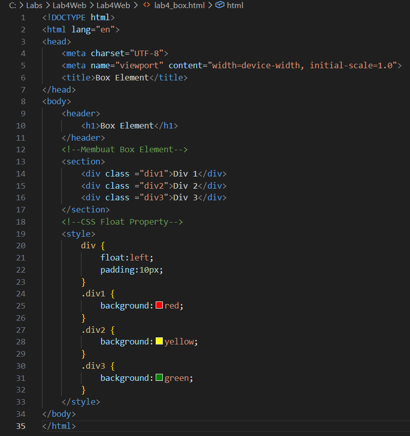
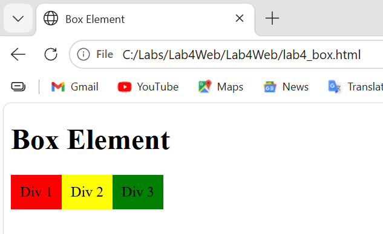
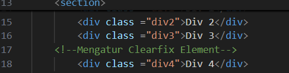
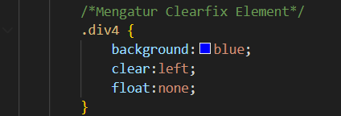
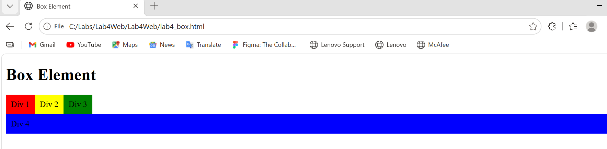
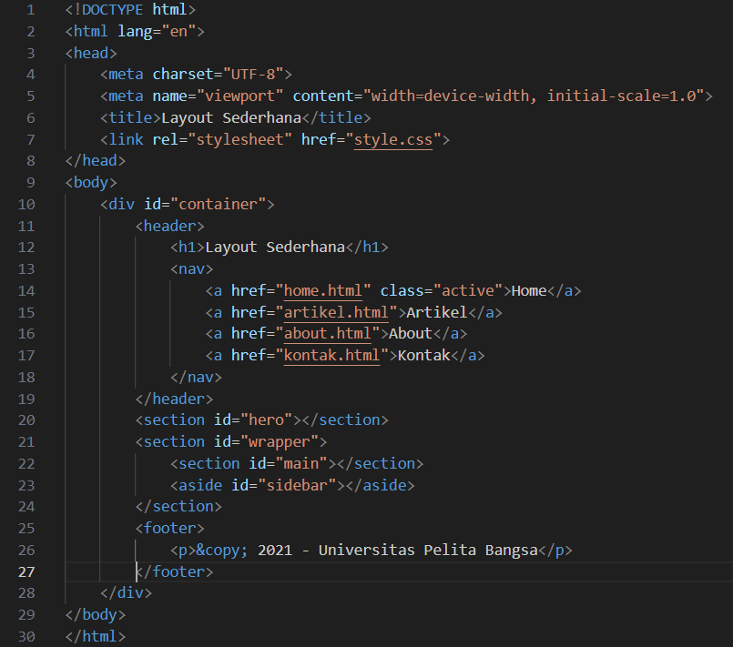
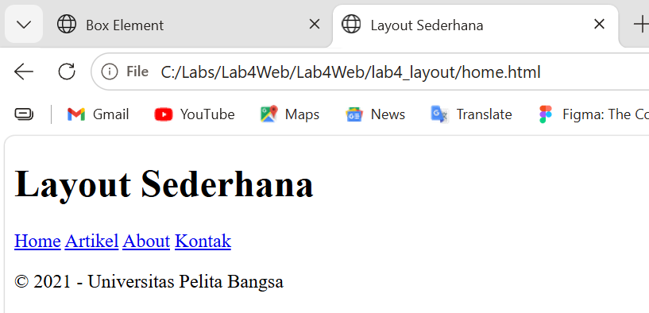
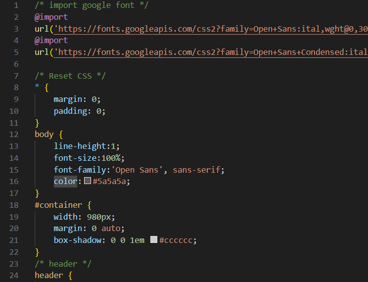
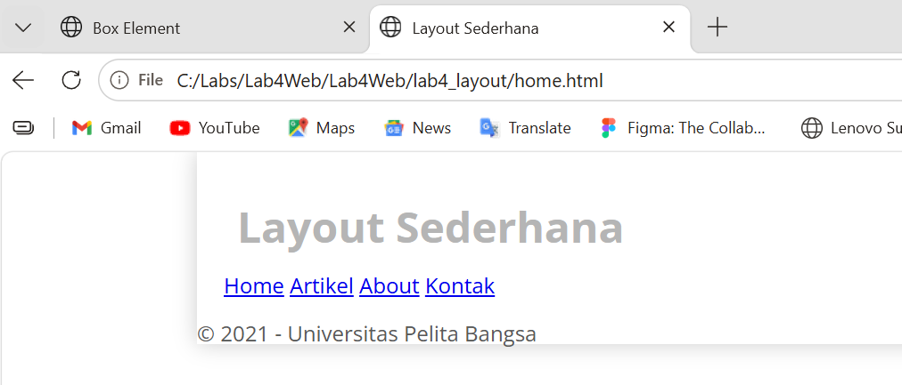

# Lab4Web
# Belajar CSS Layout
Web layout merupakan kerangka yang mengatur penempatan tata letak sebuah elemen pada halaman web.

## 1. Membuat Box Elemen
Box Elemen digunakan untuk membuat layout web.

Berikut, outputnya :

## 2. Mengatur Clearfix Elemen
Clearfix digunakan untuk mengatur element setelah float element. 
Property clear digunakan untuk mengaturnya.

Berikut, outputnya :

## 3. Membuat Layout Sederhana
Folder baru **lab4_layout** > **home.html**

Berikut, outputnya :

Lalu, buat file baru **style.css**

Hasilnya seperti ini :

