# Lab4Web
# Belajar CSS Layout
Web layout merupakan kerangka yang mengatur penempatan tata letak sebuah elemen pada halaman web.

## 1. Membuat Box Elemen
Box Elemen digunakan untuk membuat layout web.

Berikut, outputnya :

## 2. Mengatur Clearfix Elemen
Clearfix digunakan untuk mengatur element setelah float element. 
Property clear digunakan untuk mengaturnya.

Berikut, outputnya :

## 3. Membuat Layout Sederhana
### Folder baru **lab4_layout** > **home.html**

Berikut, outputnya :

### Lalu, buat file baru **style.css**

Hasilnya seperti ini :

## 4. Membuat Navigasi
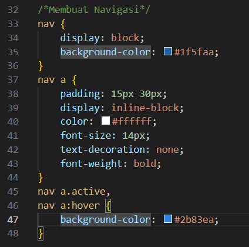
Berikut, outputnya :
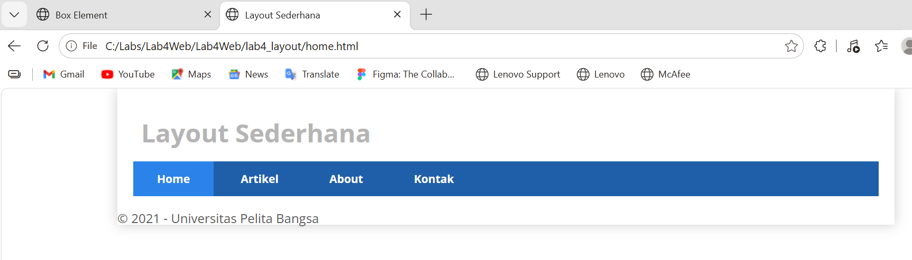

## 5. Membuat Hero Panel
Kode HTML :
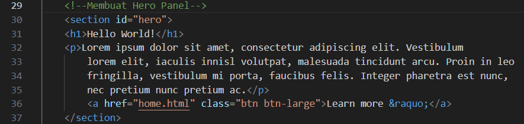
Kode CSS :
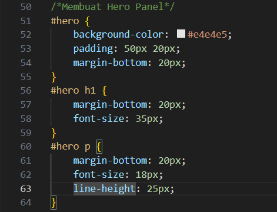
Berikut, outputnya :
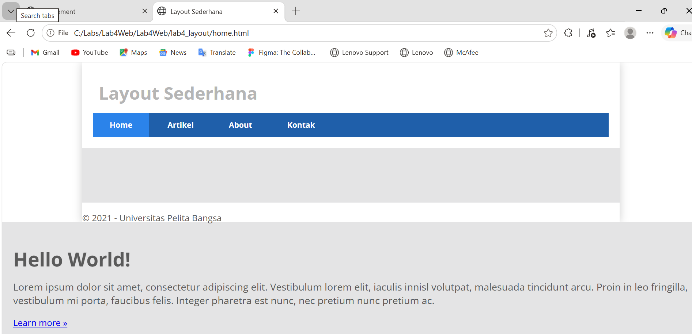

## 6. Mengatur Layout Main dan Sidebar
Menambahkan CSS Float :
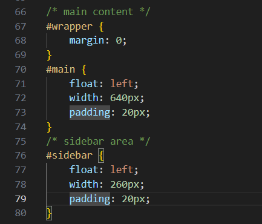
Kode HTML :
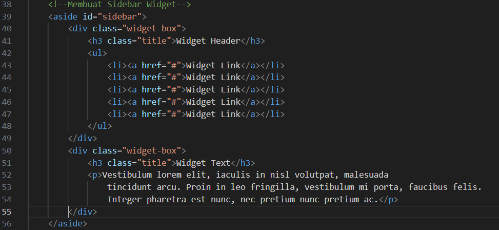
Menambahkan Widget-Box :
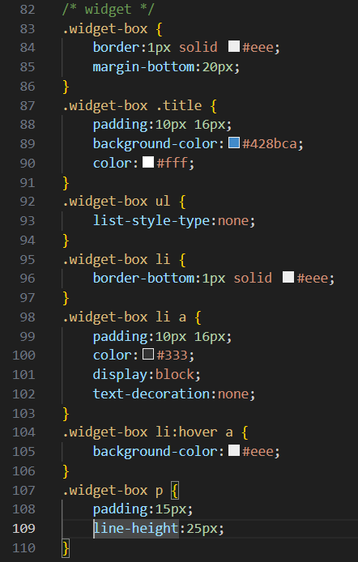
Berikut, outputnya :
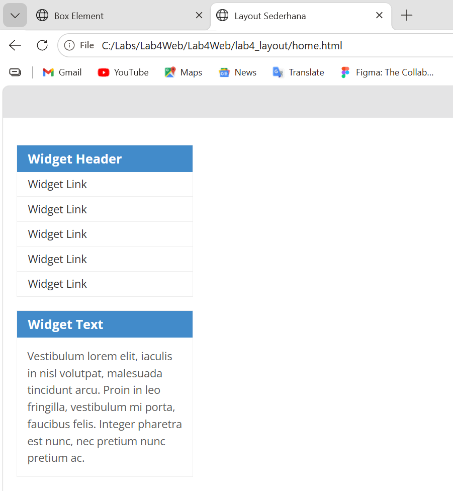

## 7. Menambahkan Elemen Lain pada Main Content
Kode HTML :
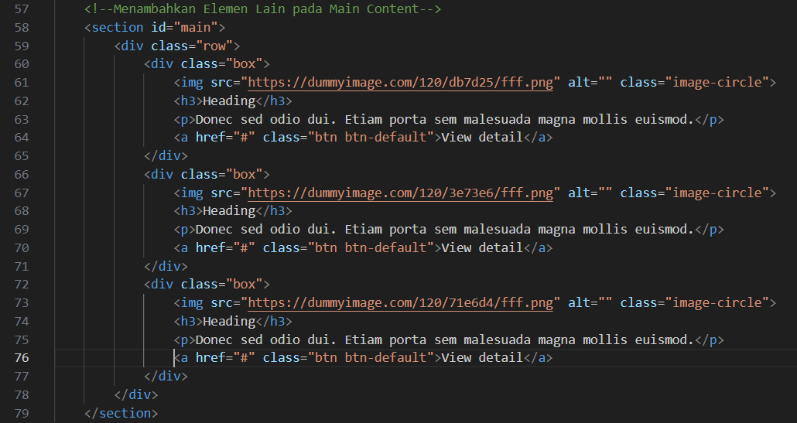
Kode CSS :
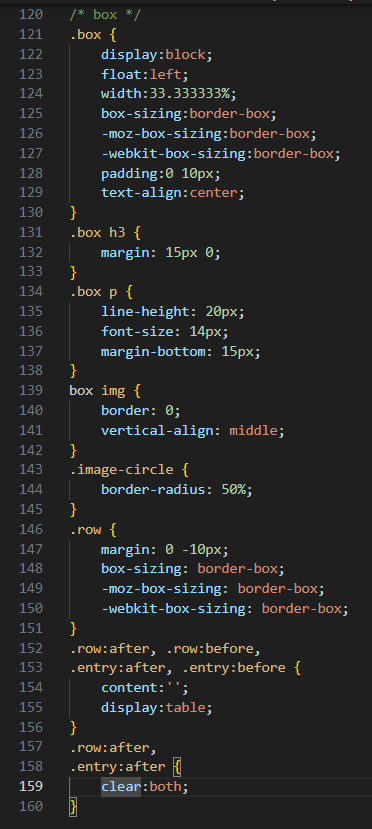
Berikut, outputnya :
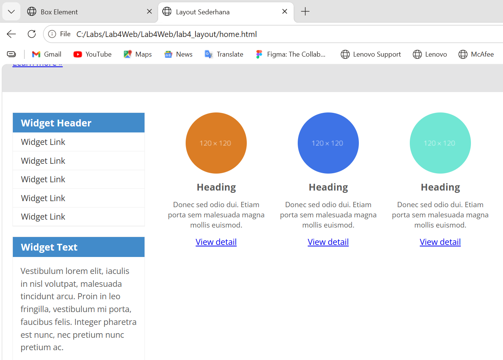

## 8. Menambahkan Content Artikel
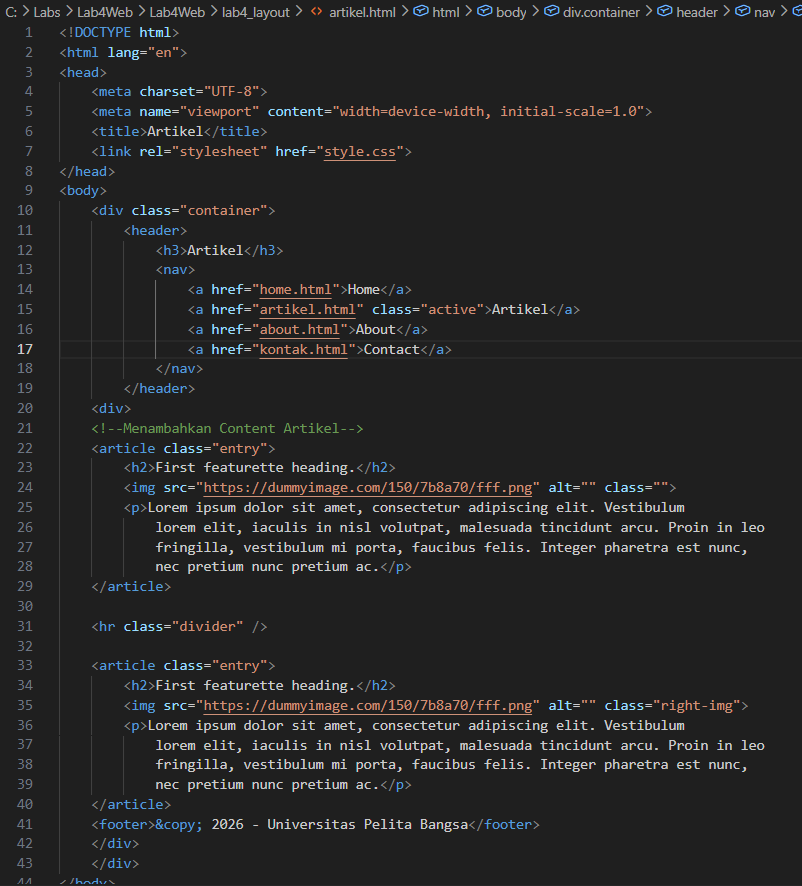
Berikut, outputnya :
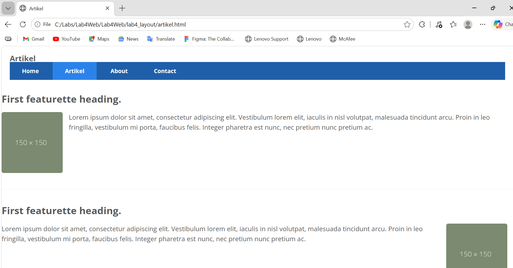

## 9. Menambahkan Menu About 
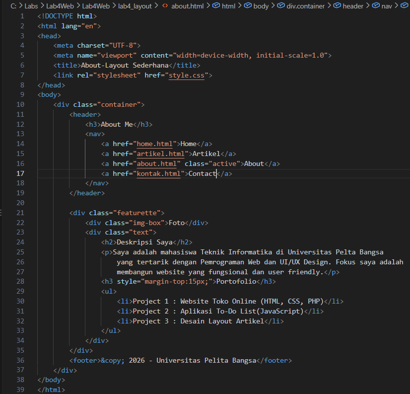
Berikut, outputnya :
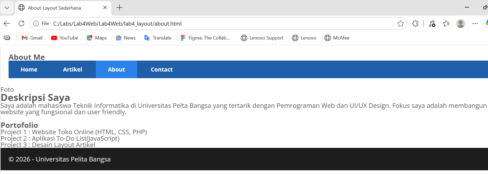

## 10. Menambahkan Menu Contact
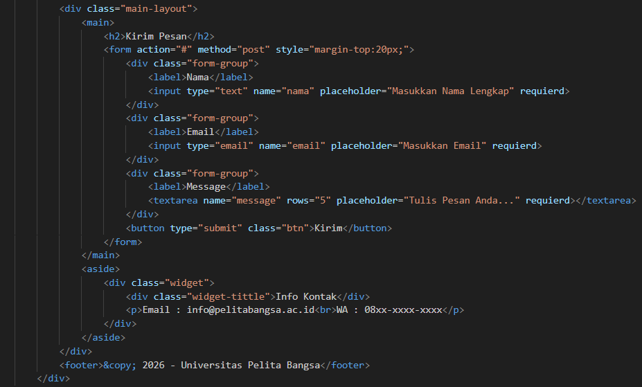
Berikut, outputnya :
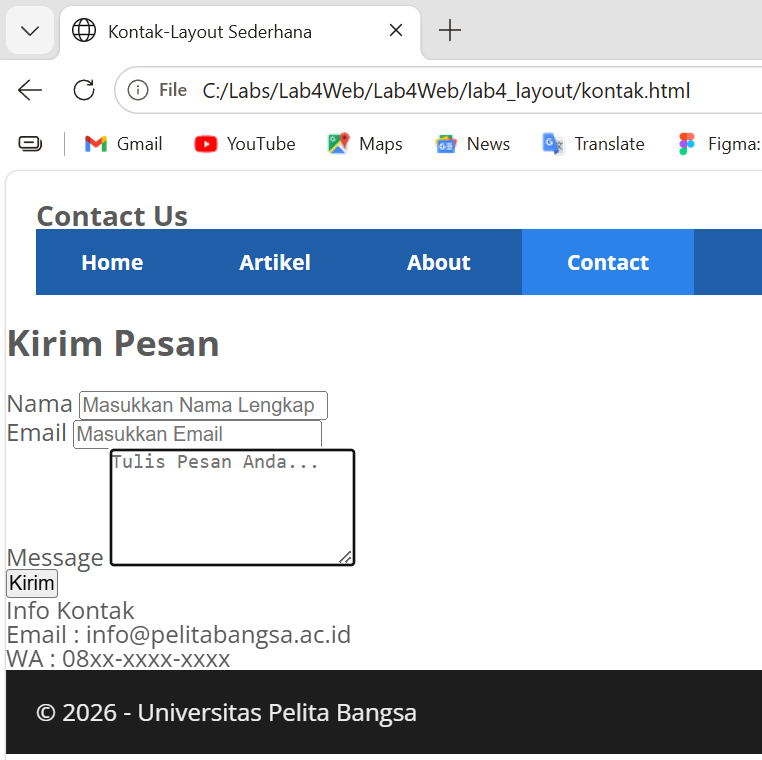

